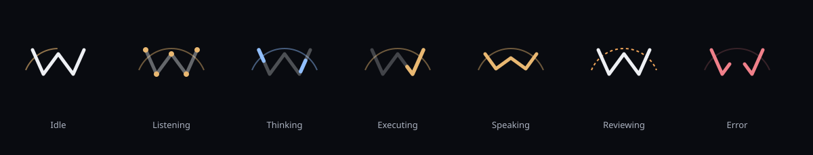
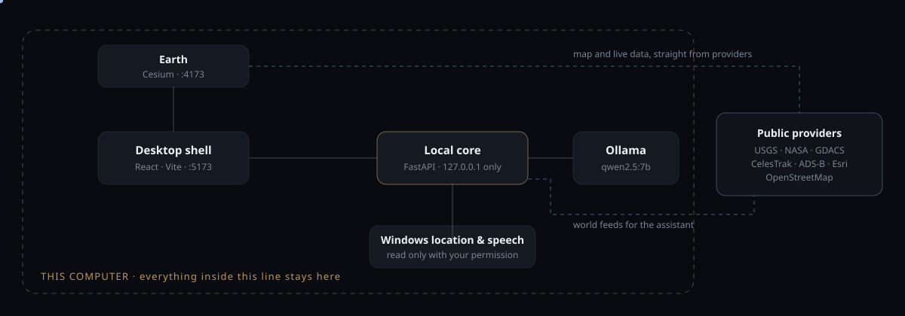

<div align="center">



<br/>

**A personal AI assistant that runs on your own computer, with a living Earth at its centre.**

Local language model · Real public data · Nothing happens without your permission

<br/>

[](https://www.python.org/)
[](https://fastapi.tiangolo.com/)
[](https://react.dev/)
[](https://cesium.com/platform/cesiumjs/)
[](https://ollama.com/)
[](https://www.microsoft.com/windows)

**[Earth](#a-living-earth)** · **[The core](#the-intelligence-core)** · **[Location](#location-you-control)** · **[Privacy](#private-by-design)** · **[Run it](#run-it)** · **[Status](#where-it-stands)**

</div>

---

## What it is

W.E.D.N.E.S.D.A.Y. is a desktop assistant for Windows 11. You talk to it, or type, and it answers with a language model running on your own machine through [Ollama](https://ollama.com/). It can use tools, such as reading the time, listing your workspace, checking earthquakes or the weather, and finding nearby places, but each one is checked by a capability broker, and anything with consequences waits for your approval.

Around it sits **World**: a full 3D globe showing live public data. It opens on the whole planet, lit by the real sun, and moves to wherever you're exploring. You can ask it questions in plain language, step back through the past month, follow what's in orbit, and point at any place to ask what happened there.

| Screen | What it does |
|---|---|
| **Mind** | The assistant: conversation, voice, approvals. |
| **World** | The living Earth, with three modes: **Live**, **Time** (history playback and comparison) and **Orbit** (satellites, aircraft, ships). |
| **Pulse** | A briefing of significant records, each with its source and time, which the local model can summarize on request. |

## A living Earth

- **The whole planet first.** Earth always opens far enough out to see the entire sphere, with day and night where they really are. Left alone, it slowly turns, and the controls fade so the planet has the stage. Move the mouse and they return.
- **An orbit dial for altitude.** An arc beside the planet carries five stops: Global, Continent, Regional, Local and Street. Its needle follows the camera's true height as you zoom.
- **Focus on me.** The camera swings around the planet until your position faces you, then descends. Your marker pulses only while the reading is current; an old reading turns grey and stops.
- **Selection reshapes the screen.** Select an aircraft, a satellite or an earthquake and everything else steps back, while its details unfold at the top. **Return to global** restores the clean view.
- **Real 3D where it helps.**
  - The aircraft you select shows a 3D model with its real trail, callsign, altitude and speed.
  - A selected satellite shows an original model on its computed orbit; rocket bodies and debris keep a plain marker, so nothing is misrepresented.
  - A selected ship shows a model facing its reported heading.
- **Honest data.** Each layer shows its source and how fresh it is. A feed that falls back or goes stale says so on screen; nothing is ever invented to fill a gap.

<details>
<summary><strong>Layers available without any key</strong></summary>

<br/>

Live aircraft, about 800 tracked satellites, the past day's earthquakes from USGS, natural events from NASA EONET, disaster alerts from GDACS, rocket launches, wildfire perimeters, undersea cables, data centres, dams, radio stations, public traffic cameras, transit, bike share, weather and air quality. With optional keys, entered in **POWER UP** on the Earth screen, you also get live ships, active fires, live traffic and photorealistic 3D cities.

</details>

## Ask the Earth

Type or say a question on the World screen, such as *"Show earthquakes above magnitude 4 today"*. The local model picks a tool, and the records it fetches go to the globe as a small, typed request (show these records, turn on this layer, focus here).

- **Earth confirms, not the model.** Each request is checked three times (backend, app, globe) and anything outside the contract is refused. The answer panel says *Waiting for Earth to confirm* until the globe reports back, then marks each request done or failed.
- **You can see how it was read.** The panel shows the tool and its arguments, the records as a clickable list, and every source with its retrieval time.
- **Invented records are flagged.** The model can write a convincing earthquake no source returned; every one the answer names is checked against the real records, and a warning appears above the answer if one doesn't match.
- **No code from the model.** It can't send scripts, URLs or commands to the globe; only the fixed list of actions exists.

**What happened here?** Press it on the globe, then click anywhere. You get the current weather there and every record from the past 7 days whose own coordinates fall within 250 km, with the sources consulted and any that couldn't be reached. Country-wide reports are never pinned to the point.

**Time.** Pick a period of up to 92 days and a minimum magnitude, then play it back day by day or compare it with another period. Records come from the USGS earthquake catalogue and NASA EONET archives; a missing archive is listed as missing, never shown as a quiet month.

## The intelligence core

The assistant's identity is a single line, the **W**, under the curve of the planet. Each state is a different behaviour of that one line, so you can read it at a glance, even without colour.

<div align="center">

</div>

| State | What it means |
|---|---|
| **Idle** | Ready. The limb slowly fills and empties, like a day passing. |
| **Listening** | The microphone is open while you hold the button. |
| **Thinking** | The local model is working. |
| **Retrieving** | A tool is fetching data. Two lights travel in along the line. |
| **Waiting for approval** | An action needs your yes. The line holds still and its ends pulse. |
| **Executing** | An action you approved is running. |
| **Speaking** | Reading the answer aloud, if you turned speech on. |
| **Reviewing** | A transcript is waiting for you to send or discard it. |
| **Error** | Something needs your attention. Nothing moves. |

## Location you control

| Mode | What happens |
|---|---|
| **Off** | Your location is never read, and any stored position is deleted. |
| **Once** (default) | One reading when you open Earth or ask for it. Nothing runs in the background. |
| **Continuous** | A background reader keeps your position current while the app runs. It stops when the app closes and resumes only if you left it on. |

While tracking runs, the top bar always shows it, with **Pause** and **Stop** one click away. Polling slows while you stay put, but never so far that the position goes stale. Only your latest position is kept, on your own machine; there is no location history.

## Private by design

<div align="center">

</div>

- **The model is local.** Conversations go to Ollama on your machine. There is no cloud model, and nothing falls back to one when the local model fails.
- **Speech is local.** Recognition and speech use Windows, or the optional offline Whisper engine. You hold a button to talk. There is no wake word, and nothing is recorded in the background.
- **Tools are checked.**
  - Every tool call passes through a capability broker that denies by default.
  - Anything with consequences waits for your one-time approval of that exact action.
  - There is no unrestricted shell access.
- **The core listens only to this computer.** The backend binds to `127.0.0.1` and rejects requests addressed to any other host.
- **The exception is Earth.** Earth's map images and live layers come straight from their public providers, so those providers see which area you're viewing.

## Run it

**You need:** Windows 11, Python 3.12, Node.js 20 or newer, Git, and [Ollama](https://ollama.com/) with `qwen2.5:7b` pulled.

```powershell
git clone https://github.com/Samudra-GITHub/F.R.I.D.A.Y.git
cd F.R.I.D.A.Y.
python -m venv .venv
.venv\Scripts\pip install -e .[dev]
npm --prefix apps/desktop install
```

Earth is built on an open-source CesiumJS app (MIT), with this project's changes kept as a patch:

```powershell
git clone https://github.com/bilawalsidhu/gods-eye-view.git apps/gods-eye-view
git -C apps/gods-eye-view checkout a725178
git -C apps/gods-eye-view apply ../../patches/wednesday-earth.patch
$env:PUPPETEER_SKIP_DOWNLOAD = "1"; npm --prefix apps/gods-eye-view ci
```

Start the backend and the desktop app, each in its own terminal. The desktop app starts Earth by itself.

```powershell
.venv\Scripts\python scripts/dev_backend.py --port 8000
```

```powershell
npm --prefix apps/desktop run dev
```

Then open <http://localhost:5173>. For the microphone, use Chrome or Edge.

<details>
<summary><strong>Optional settings (<code>.env</code> in the project folder)</strong></summary>

<br/>

Copy `.env.example` to `.env`. Values are never logged.

| Variable | Effect |
|---|---|
| `FIRMS_MAP_KEY` | Active fires for the assistant's tools (free NASA key) |
| `OSM_CONTACT_EMAIL` | Identifies you to OpenStreetMap's Nominatim, as its usage policy asks |
| `FRIDAY_STT_PROVIDER` | `windows_sapi` (default) or `faster_whisper` |
| `FRIDAY_WHISPER_MODEL` | Folder of a downloaded faster-whisper model |
| `FRIDAY_MODEL_TIMEOUT` | Seconds allowed per model reply (default 300) |

Keys for Earth's own layers go in **POWER UP** on the Earth screen instead.

</details>

<details>
<summary><strong>Tests</strong></summary>

<br/>

```powershell
.venv\Scripts\python -m pytest -q --ignore=tests/integration/test_ollama_live.py --ignore=tests/integration/test_real_windows_location.py
npm --prefix apps/desktop test
npm --prefix apps/desktop run build
npm --prefix apps/gods-eye-view test
```

At the last full run: backend 232 passed; desktop 45 passed, with a clean type check and build; Earth 9,117 passed and 11 skipped of 9,130. Two timing tests failed under load and passed when run alone; see [verification](docs/overhaul/verification.md).

</details>

## Where it stands

**Working and checked in the running app:**
- the whole-planet opening, orbit dial, Focus on me, and focus mode for real aircraft, satellites, and earthquakes
- 3D models for the selected aircraft and satellite
- all three location modes, with Pause and Stop
- the seven states of the core, including **executing** while a tool runs
- the redesigned Activity, Memory, Security, and Settings screens, and the phone layout
- what happens when things go wrong: a stopped backend, denied location permission (simulated), a graphics (WebGL) failure, plus the Cyber layout and the cockpit view
- Ask the Earth with the real local model, Pulse with Show on Earth, Time playback, Orbit with Follow the ISS, and What happened here?

**Not yet verified:**
- voice recognition on a real microphone
- frame rate on a dedicated graphics card
- Ask the Earth replies on a GPU: on this machine Ollama finds no NVIDIA GPU, so a question takes about 6 minutes on the CPU
- live ships, which need an AISStream key

More detail is in [docs/overhaul](docs/overhaul).

## Acknowledgements

- **Earth:** builds on [gods-eye-view](https://github.com/bilawalsidhu/gods-eye-view) by Bilawal Sidhu (MIT) and [CesiumJS](https://cesium.com/platform/cesiumjs/).
- **Aircraft models:** used under CC BY 4.0, credited in that project's `public/models/README.md`. The satellite and ship models are original to this project.
- **Data:**
  - Map imagery from Esri.
  - Geocoding and places © [OpenStreetMap](https://www.openstreetmap.org/copyright) contributors.
  - Earthquakes from USGS; natural events from NASA EONET; disaster alerts from GDACS; weather from Open-Meteo; orbits from CelesTrak; aircraft from adsb.lol and OpenSky.
- **Local model:** runs through [Ollama](https://ollama.com/).

<div align="center">
<br/>
<sub>Built by <a href="https://github.com/Samudra-GITHub">Samudra Kar</a></sub>
</div>
