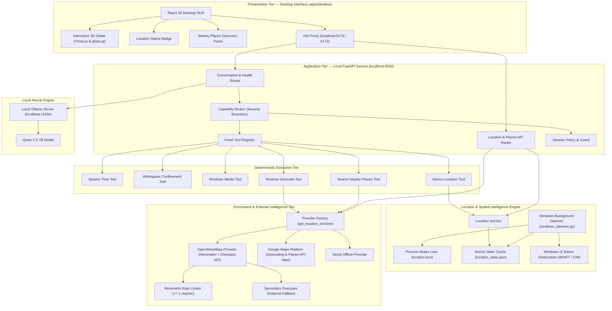

<div align="center">


# F . R . I . D . A . Y .

**Next-Generation Local-First Personal AI Assistant & World Intelligence Interface**

[](https://www.python.org/)
[](https://fastapi.tiangolo.com/)
[](https://react.dev/)
[](https://www.typescriptlang.org/)
[](https://threejs.org/)
[](https://ollama.com/)
[](https://www.openstreetmap.org/)
[](https://www.microsoft.com/windows)
[](#security--privacy-architecture)
[](https://opensource.org/licenses/MIT)

<p align="center">
  <em>F.R.I.D.A.Y. (Female Replacement Intelligent Digital Assistant Youth) is a local-first, privacy-governed personal AI operating system inspired by the Marvel universe. Built with an application-enforced Capability Broker, an interactive 3D World Intelligence globe, continuous Windows location awareness, and zero-paid-API OpenStreetMap spatial intelligence, F.R.I.D.A.Y. pairs deterministic OS execution with local neural reasoning.</em>
</p>

</div>

---

## Table of Contents

- [Overview](#overview)
- [Vision & Design Philosophy](#vision--design-philosophy)
- [Key Features](#key-features)
- [System Architecture](#system-architecture)
- [Technology Stack](#technology-stack)
- [How It Works](#how-it-works)
- [Prerequisites](#prerequisites)
- [Installation & Setup](#installation--setup)
- [Configuration & Environment Variables](#configuration--environment-variables)
- [Running the Application](#running-the-application)
- [Running the Test Suite](#running-the-test-suite)
- [Security & Privacy Architecture](#security--privacy-architecture)
- [Known Limitations](#known-limitations)
- [Roadmap](#roadmap)
- [Contributing](#contributing)
- [License & Acknowledgements](#license--acknowledgements)

---

## Overview

Most modern AI assistants operate as opaque cloud wrappers that blindly execute arbitrary instructions or summarize conversation streams. **F.R.I.D.A.Y.** rethinks desktop AI from first principles as an auditable, high-reliability personal intelligence platform.

F.R.I.D.A.Y. decouples **probabilistic neural reasoning** from **deterministic execution authority**:
1. **The Neural Model Proposes:** A local large language model (Qwen 2.5 7B via Ollama) processes user requests and constructs tool execution proposals.
2. **The Capability Broker Decides:** An independent, hardcoded security policy broker inspects every proposed action against fixed schema definitions, session permission sets, and strict filesystem confinement before any operating system action can execute.
3. **The Spatial Engine Grounds:** An interactive 3D WebGL globe contextualizes global and local intelligence, pairing live Windows hardware geolocation with community-driven OpenStreetMap points of interest.

The entire core runs exclusively on localhost (`127.0.0.1`), preserving absolute data sovereignty with zero telemetry leakage.

---

## Vision & Design Philosophy

- **Local-First by Default:** All core intelligence runs on your hardware. Conversation history, device telemetry, and filesystem access never leave your machine.
- **Zero Fabrication Policy:** When a service, coordinate fix, weather station, or external provider is unconfigured, offline, or unavailable, F.R.I.D.A.Y. reports its exact status honestly (`no_fix`, `provider_not_configured`, `rate_limited`, `timeout`) rather than hallucinating places, ratings, or readings.
- **Minimalist Cinematic Aesthetics:** Inspired by the restraint of aerospace telemetry HUDs and cinematic science-fiction interfaces. Deep space obsidian canvas, electric cyan holographic energy orb, midnight navy control panels, and violet orbital markers.
- **Shared Infrastructure Stewardship:** Open-source community APIs (such as OpenStreetMap Nominatim and Overpass) are shared public goods. F.R.I.D.A.Y. honors upstream usage policies with strict client-side rate limiting (<= 1 request/sec), in-flight deduplication, bounded TTL caching, and automatic fallback endpoints.

---

## Key Features

### 1. Interactive 3D World Intelligence Globe
- **WebGL Geospatial Canvas:** Built with Three.js and `globe.gl`, featuring smooth orbital rotation, camera fly-to animations, and coordinate raycasting.
- **Modular Data Layers:** Real-time visual toggles for global news events, seismic activity with magnitude-scaled markers, atmospheric weather stations, and orbital trajectory indicators.
- **Interactive POI Markers:** Dynamic violet markers for resolved nearby places with single-click camera focus.

### 2. Spatial Intelligence & Nearby Places Discovery
- **Free OpenStreetMap Provider (Default):** Complete location intelligence without paid API keys.
  - **Reverse Geocoding:** Converts latitude/longitude into formatted street addresses and administrative areas via Nominatim.
  - **Points of Interest:** Queries Overpass API across 6 core categories:
    - 🏥 Hospitals & Clinics (`amenity=hospital|clinic`)
    - 💊 Pharmacies & Chemists (`amenity=pharmacy`)
    - ⛽ Fuel & EV Charging Stations (`amenity=fuel|charging_station`)
    - ☕ Cafes & Coffee Shops (`amenity=cafe`)
    - 🍽️ Restaurants & Dining (`amenity=restaurant|fast_food`)
    - 🛒 Grocery Stores & Supermarkets (`shop=supermarket|convenience|grocery`)
  - **Overpass Fallback Redundancy:** Automatic seamless rollover from `overpass-api.de` to `overpass.kumi.systems` on timeouts or HTTP 5xx/429 limits.
  - **Usage Policy Enforcement:** Strict client-side rate limiting (<= 1.0s gap via `NominatimRateLimiter`), concurrent request deduplication, and 10-minute bounded caching.
- **Optional Google Maps Provider:** Native integration with Google Geocoding API and Google Places API (New) when `GOOGLE_MAPS_API_KEY` is provided.
- **Offline / No-Op Provider:** Transparent offline operation reporting `provider_not_configured` without breaking device location tracking.

### 3. Windows 11 Always-On Location Intelligence
- **Native OS Provider:** Reads device coordinates and horizontal accuracy from Windows Geolocation (WinRT / CIM).
- **Background Worker Daemon:** Standalone background polling worker (`windows_daemon.py`) that continues updating location telemetry even when the browser dashboard is closed.
- **Process Mutex & Recovery:** Single-instance file lock (`location.lock`) with atomic state persistence (`location_state.json`) and safe stale-PID recovery.
- **Consent Separation:** Explicit permissions separate reading device coordinates (`LOCATION_READ`) from starting, pausing, or stopping continuous tracking (`LOCATION_CONTROL`).

### 4. Application-Enforced Capability Broker
- **Zero Prompt-Injection Execution:** The language model cannot execute shell commands or grant itself permissions. Every tool call proposal must pass through the `CapabilityBroker`.
- **Strict Schema Validation:** Strict argument type, enum, and boundary checks against declared schemas.
- **Untrusted Content Tainting:** All file contents, command results, and external API responses are explicitly tagged as untrusted data.
- **Workspace Confinement:** Filesystem inspection is strictly confined to an authorized workspace directory (`FridayWorkspace`), actively rejecting directory traversal sequences (`..`), drive escapes, and null bytes.

---

## System Architecture

The following diagram illustrates F.R.I.D.A.Y.'s decoupled, multi-tiered architecture:



---

## Technology Stack

| Layer | Technology | Version | Purpose |
| :--- | :--- | :--- | :--- |
| **Backend Framework** | [FastAPI](https://fastapi.tiangolo.com/) | `>= 0.115.0` | High-performance asynchronous REST API, strictly bound to `127.0.0.1` |
| **ASGI Server** | [Uvicorn](https://www.uvicorn.org/) | `>= 0.30.0` | Production ASGI web server implementation |
| **Data Contracts** | [Pydantic](https://docs.pydantic.dev/) | `>= 2.8.0` | Strict data validation, schema enforcement, and setting management |
| **HTTP Client** | [HTTPX](https://www.python-httpx.org/) | `>= 0.27.0` | Async HTTP client with connection pooling and mock transport support |
| **Frontend Framework** | [React](https://react.dev/) | `^18.3.1` | Component-driven desktop HUD user interface |
| **Language** | [TypeScript](https://www.typescriptlang.org/) | `~5.6.3` | Type-safe frontend client development |
| **Build & Bundler** | [Vite](https://vitejs.dev/) | `^5.4.11` | Ultra-fast frontend development server and rollup packager |
| **3D Geospatial Engine** | [Three.js](https://threejs.org/) & [globe.gl](https://globe.gl/) | `^0.186` / `^2.46` | Interactive WebGL globe visualization with orbital camera controls |
| **Local LLM Engine** | [Ollama](https://ollama.com/) | Latest | Local model execution runtime hosting `qwen2.5:7b` |
| **Spatial Providers** | [OpenStreetMap](https://www.openstreetmap.org/) | Nominatim / Overpass | Free, community-driven reverse geocoding and point-of-interest discovery |
| **OS Telemetry** | [Windows Geolocation](https://learn.microsoft.com/en-us/uwp/api/windows.devices.geolocation) | WinRT / CIM | Hardware and network device location fixes on Windows 11 |

---

## How It Works

```
[ User Interaction ] ──> [ React Desktop HUD ] ──> [ Vite Proxy ]
                                                         │
                                                         ▼
[ Verified State ] <── [ Capability Broker ] <── [ FastAPI Backend ]
        │                       │
        ▼                       ▼
[ Deterministic Tools ]   [ Model Proposal ] <── [ Local Ollama ]
  ├── Windows Location Daemon
  ├── OpenStreetMap / Overpass POI
  └── Workspace Confinement
```

1. **User Request / Coordinate Event:** The user enters a natural language query in the HUD, clicks a geographic coordinate on the 3D globe, or triggers a nearby POI search.
2. **Intent Formation:** The backend queries the local Ollama instance (`qwen2.5:7b`). The model returns a structured `ToolCallProposal` containing the intended tool name and arguments.
3. **Capability Broker Evaluation:** Before any tool code is invoked, the `CapabilityBroker` independently validates:
   - Does the tool exist in the fixed registry?
   - Do proposed arguments conform to the strict JSON schema?
   - Does the active session have the required permission (e.g., `places:search`, `location:read`)?
   - Does the subpath violate workspace confinement?
4. **Deterministic Execution:** The authorized tool executes independently. If reverse geocoding or nearby places are requested, `OpenStreetMapLocationEnricher` verifies coordinates, checks in-memory cache, rate-limits queries, and queries Nominatim or Overpass.
5. **State Verification & Response:** The tool returns an untrusted payload along with an independent verification verdict. Results are rendered as visual POI cards in the Nearby Places dock and plotted as violet markers on the 3D globe.

---

## Prerequisites

Before installing F.R.I.D.A.Y., ensure your workstation meets the following requirements:

1. **Operating System:** Windows 11 (64-bit) recommended for native location provider; Windows 10 supported with mock/fallback providers.
2. **Python:** Version `3.11` or `3.12` (64-bit). Verify with:
   ```powershell
   python --version
   ```
3. **Node.js & npm:** Node.js `18.x` or `20.x` LTS. Verify with:
   ```powershell
   node --version
   npm --version
   ```
4. **Ollama:** Installed and accessible via CLI. Download from [ollama.com](https://ollama.com/).
   ```powershell
   ollama pull qwen2.5:7b
   ```

---

## Installation & Setup

Open **Windows PowerShell** and follow these steps:

### 1. Clone the Repository
```powershell
git clone https://github.com/Samudra-GITHub/F.R.I.D.A.Y.git
cd F.R.I.D.A.Y
```

### 2. Configure Python Backend Virtual Environment
```powershell
# Create virtual environment
python -m venv .venv

# Activate virtual environment
.\.venv\Scripts\Activate.ps1

# Upgrade pip and install backend dependencies
python -m pip install --upgrade pip
pip install -e .
pip install pytest pytest-asyncio
```

### 3. Install Desktop Frontend Dependencies
```powershell
cd apps\desktop
npm install
cd ..\..
```

---

## Configuration & Environment Variables

F.R.I.D.A.Y. comes with a template environment configuration file. Create your local `.env` file:

```powershell
Copy-Item .env.example .env
```

### Supported Configuration Keys

| Variable | Default Value | Description |
| :--- | :--- | :--- |
| `LOCATION_PROVIDER` | `osm` | Active place intelligence provider: `osm` (Free OpenStreetMap), `google`, or `none`. |
| `OSM_NOMINATIM_URL` | `https://nominatim.openstreetmap.org/reverse` | Reverse geocoding endpoint for coordinates to addresses. |
| `OSM_OVERPASS_URL` | `https://overpass-api.de/api/interpreter` | Primary Overpass QL endpoint for nearby points of interest. |
| `OSM_OVERPASS_FALLBACK_URL` | `https://overpass.kumi.systems/api/interpreter` | Documented fallback endpoint when primary endpoint experiences load. |
| `OSM_USER_AGENT` | `FRIDAY-Assistant/0.1.0` | Custom identifying user agent for OpenStreetMap usage policy compliance. |
| `OSM_CONTACT_EMAIL` | `None` | Optional contact email appended to User-Agent per Nominatim policy. |
| `GOOGLE_MAPS_API_KEY` | `None` | Optional Google Maps Platform key (only used when `LOCATION_PROVIDER=google`). |
| `FRIDAY_WORKSPACE` | `~\FridayWorkspace` | Absolute directory path where file inspection is strictly confined. |
| `FRIDAY_LOCATION_STATE` | `~/.friday/location_state.json` | Persistent cache file storing the latest device location fix. |
| `FRIDAY_LOCATION_LOCK` | `~/.friday/location.lock` | Mutex file preventing multiple background location daemons. |
| `OLLAMA_BASE_URL` | `http://127.0.0.1:11434` | Endpoint for the local Ollama neural model server. |
| `MODEL_NAME` | `qwen2.5:7b` | Specific local model identifier executed by Ollama. |

> **Note on OpenStreetMap Usage Policies:**  
> Free public OpenStreetMap servers are community-supported infrastructure. F.R.I.D.A.Y. enforces Nominatim's strict requirement of no more than 1 request per second and automatically caches results. Do not scrape or use public endpoints for heavy load testing.

---

## Running the Application

To run the complete F.R.I.D.A.Y. intelligence system, launch the services in separate PowerShell terminals:

### Terminal 1: Local Neural Model Engine (Ollama)
```powershell
ollama serve
```

### Terminal 2: FastAPI Localhost Backend
```powershell
# From the project root with .venv activated:
.\.venv\Scripts\Activate.ps1
uvicorn backend.friday.api.app:app --host 127.0.0.1 --port 8000 --reload
```
- Core Health Check: `http://127.0.0.1:8000/health`
- Location Status: `http://127.0.0.1:8000/location/status`

### Terminal 3: Desktop HUD (React + Vite)
```powershell
cd apps\desktop
npm run dev
```
- Open `http://127.0.0.1:5173` in your browser.

### Terminal 4 (Optional): Background Windows Location Daemon
Continuous device location tracking can run as an independent background daemon:
```powershell
.\.venv\Scripts\Activate.ps1
python -m backend.friday.location.windows_daemon --interval 60
```
*(Alternatively, simply click "Enable Tracking" inside the Desktop HUD to launch and control the background worker via the API).*

---

## Running the Test Suite

F.R.I.D.A.Y. maintains a zero-external-dependency test policy: automated tests strictly use mocked HTTP transports, ensuring that running tests never makes paid API calls or abuses public community servers.

### Run All Backend Python Tests (96 Passing Tests)
```powershell
.\.venv\Scripts\Activate.ps1
pytest -v
```

<details>
<summary><strong>View Test Coverage Breakdown</strong></summary>

- `test_osm_enricher.py`: 14 tests verifying Nominatim 1-req/sec rate limiting, in-flight request deduplication, address extraction, Overpass QL query construction, centroid coordinates, fallback endpoint recovery, and Capability Broker authorization.
- `test_enrichment_provider.py`: 11 tests covering coordinate range validation, Haversine calculations, coordinate log masking, and Google Maps provider mocking.
- `test_places_broker.py`: 6 tests verifying capability broker permission isolation (`places:search`), unknown tool rejection, and honest unconfigured verification.
- `test_location_state_and_daemon.py`: Atomic state file writes, lock acquisition, and stale PID recovery.
- `test_location_provider.py`: Windows location status parsing and offline guarantees.
- `test_workspace_security.py`: Confinement checks preventing directory traversal (`..`), drive escapes, and null-byte injection.
- `test_adversarial.py`: Adversarial prompt injection resistance.
</details>

### Run Frontend Desktop Tests (24 Passing Tests)
```powershell
cd apps\desktop
npm test
```

### Build Production Bundle
```powershell
cd apps\desktop
npm run build
```

---

## Security & Privacy Architecture

F.R.I.D.A.Y. is designed around a zero-trust model between the LLM and the operating system:

```
┌─────────────────────────────────────────────────────────────┐
│                      CAPABILITY BROKER                      │
│                                                             │
│   [ Model Proposal ] ──> [ Permission Check ] ──> REJECT   │
│                                   │                         │
│                                   ▼                         │
│                           [ Schema Validation ] ──> REJECT  │
│                                   │                         │
│                                   ▼                         │
│                          [ Workspace Boundary ] ──> REJECT  │
│                                   │                         │
│                                   ▼                         │
│                           [ Execute Tool ]                  │
│                                   │                         │
│                                   ▼                         │
│                      [ Independent Verify ]                 │
└─────────────────────────────────────────────────────────────┘
```

1. **Strict Localhost Binding:** Network bindings are restricted to `127.0.0.1`. No external ports or cloud listeners are opened.
2. **Coordinate Masking:** Raw device coordinates are never written to server logs or traces. Coordinates are masked as `(28.***, 77.***)` to prevent telemetry leakage in logs.
3. **Fine-Grained Permissions:**
   - `LOCATION_READ`: Permission to read the current cached fix.
   - `LOCATION_CONTROL`: Permission to start, pause, or terminate the background daemon.
   - `PLACES_SEARCH`: Permission to query external enrichment providers.
   The model cannot grant itself permissions or implicitly enable tracking.
4. **Input Sanitization & Overpass Defense:** Query parameters for nearby places are rigorously sanitized against Overpass QL injection, stripping quotes, backslashes, and semicolon control sequences.
5. **No Shell Execution:** F.R.I.D.A.Y. intentionally lacks generic shell or code evaluation tools. Actions are limited to deterministic, dedicated adapters.

---

## Known Limitations

- **Windows Geolocation:** The native background location provider uses Windows 11 WinRT APIs. On Linux or macOS, the location service operates in fallback/mock mode.
- **Shared Public API Capacity:** OpenStreetMap public servers are community-supported. Heavy query bursts will trigger HTTP 429 rate limits, which F.R.I.D.A.Y. handles gracefully via exponential backoff and secondary endpoint fallback.
- **Ratings in OSM:** OpenStreetMap data does not provide standardized user ratings. In accordance with our Zero Fabrication policy, rating badges are omitted for OSM places rather than invented.
- **Telemetry Feeds:** Atmospheric weather and seismic telemetry on the 3D globe currently utilize sample fixture datasets; live multi-source satellite telemetry streaming is scheduled for Phase 3.

---

## Roadmap

```
  [x] Milestone 1: Core Foundation & Capability Broker
  [x] Phase 2A: Interactive 3D World Intelligence Globe & HUD
  [x] Phase 2B: Windows Always-On Location Intelligence Daemon
  [x] Phase 2C: Google Maps Platform Provider & Places Search
  [x] Phase 2D: Free OpenStreetMap Location Intelligence (Nominatim + Overpass)
  [ ] Phase 3: Real-Time Live Global Telemetry Gateway (USGS, NOAA, Open-Meteo)
  [ ] Phase 4: Bi-directional Voice Synthesis & Multimodal Audio Core
```

- [x] **Milestone 1 — Core Security Architecture:** Localhost FastAPI core, Capability Broker, Session Policy, fixed tool registry, and workspace confinement.
- [x] **Phase 2A — World Intelligence UI:** Three.js and `globe.gl` 3D globe, holographic HUD energy orb, and activity audit logging.
- [x] **Phase 2B — Windows Location Service:** Native WinRT geolocation provider, background worker daemon, atomic lock state management, and status badges.
- [x] **Phase 2C — Google Maps Integration:** Optional Google Geocoding and Google Places API (New) provider with strict attribution and caching.
- [x] **Phase 2D — OpenStreetMap Provider:** Free, no-API-key location intelligence via Nominatim and Overpass API with rate-limiting, deduplication, and endpoint fallback.
- [ ] **Phase 3 — Live Telemetry Gateway:** Real-time data connectors for USGS real-time earthquakes, Open-Meteo weather forecasts, and live orbital satellite ephemeris.
- [ ] **Phase 4 — Neural Audio Core:** Streaming voice recognition and low-latency local text-to-speech synthesis.

---

## Contributing

Contributions from developers, security researchers, and AI enthusiasts are welcome! Please follow these principles:

1. **Maintain Security Invariants:** Never add arbitrary shell execution tools or bypass the `CapabilityBroker`.
2. **Preserve Zero-Fabrication Guarantees:** Do not mock or invent telemetry readouts in production code. Always report provider status honestly.
3. **Write Mocked Tests:** All tests involving external APIs must use `httpx.MockTransport` or equivalent mocks. Zero live network calls during automated test execution.
4. **Code Quality:** Ensure all tests pass before opening a PR:
   ```powershell
   pytest
   npm test --prefix apps/desktop
   npm run build --prefix apps/desktop
   ```

---

## License & Acknowledgements

### License
This project is licensed under the [MIT License](https://opensource.org/licenses/MIT).

### Data & Attribution Acknowledgements
- **OpenStreetMap Data:** Geocoding and point-of-interest data © [OpenStreetMap](https://www.openstreetmap.org/copyright) contributors. OpenStreetMap data is licensed under the [Open Database License (ODbL)](https://opendatacommons.org/licenses/odbl/).
- **Inspiration:** Inspired by F.R.I.D.A.Y. from the Marvel Cinematic Universe created by Marvel Studios.
- **Open Source Ecosystem:** Powered by [FastAPI](https://fastapi.tiangolo.com/), [Ollama](https://ollama.com/), [Three.js](https://threejs.org/), and [globe.gl](https://globe.gl/).

---

<div align="center">
  <sub>Engineered by <a href="https://github.com/Samudra-GITHub">Samudra Kar</a> • F.R.I.D.A.Y. Intelligence System</sub>
</div>
